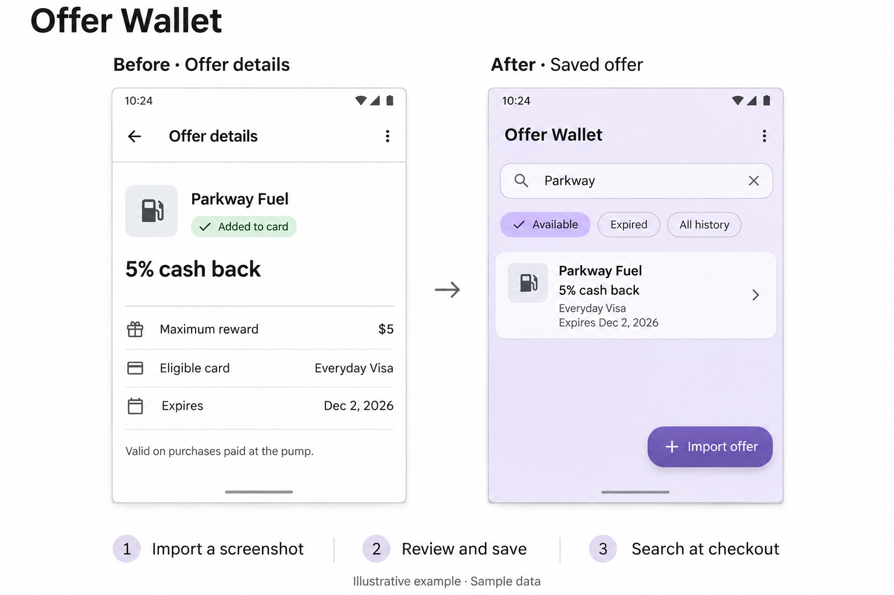

# Offer Wallet

Keeping track of credit card offers took more attention than it should. With offers spread across bank apps, I had to remember which store had a deal, which card to use, and when it expired. Saving screenshots just gave me one more place to look at checkout.

I built **Offer Wallet** so I could look it all up in one place. Import an offer screenshot, then search the store before you pay to see the card, reward, and expiration date together.



## How it works

1. **Add your cards.** Give each card a nickname and enter its issuer and last four or five digits.
2. **Import a screenshot.** Offer Wallet reads the offer on your phone. Check the details, make any corrections, and tap **Save offer**.
3. **Find an offer at checkout.** Search by store or filter by card. Mark an offer as used after you redeem it. Expired offers move out of your available list automatically.

No account or API key required. Your saved offers stay on your phone. Screenshot recognition includes layouts from Amex, Chase, and Capital One.

## Build and run

Version 1.9.0 runs on Android 9 (API 28) and later. The project uses Kotlin, Jetpack Compose, SQLite, and the bundled ML Kit Latin text recognition model.

1. Install JDK 17, Gradle 8.10.2, and Android SDK Platform 35 with Build Tools 35.0.0. Configure the Android SDK location in Android Studio or set ANDROID_HOME for the command line.
2. Open the directory containing `settings.gradle.kts` in Android Studio. In the Gradle settings select JDK 17 and your local Gradle 8.10.2 installation, then sync.
3. Select an emulator or an Android phone with USB debugging enabled and run the **app** configuration.

From the same project root, with Gradle on PATH:

```sh
gradle :app:assembleDebug
```

The debug APK is written to `app/build/outputs/apk/debug/app-debug.apk`. The included GitHub Actions workflow runs this build on pushes and pull requests. The first build requires internet access to download dependencies.

## Data and privacy

OCR runs on the phone. The local SQLite database stores card nicknames and suffixes, offer fields, recognized text, and a reference to the selected screenshot. Android cloud backup is disabled in the app manifest. Version 1.9.0 supports a single Android device. Cross-device sync and iPhone support are planned.

## Reporting an OCR issue

Include the app version, issuer, expected field value, and actual value. A synthetic example is ideal. If a screenshot is essential, redact identifying details and card or account numbers before posting a public issue.

Offer Wallet is an independent project and is unaffiliated with the card issuers.
